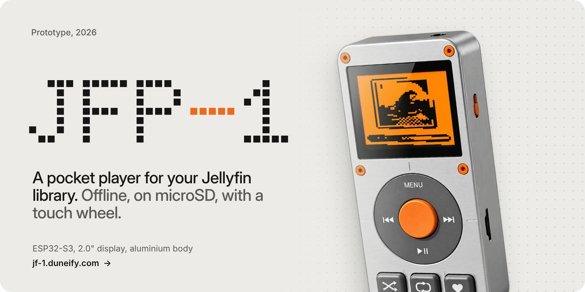
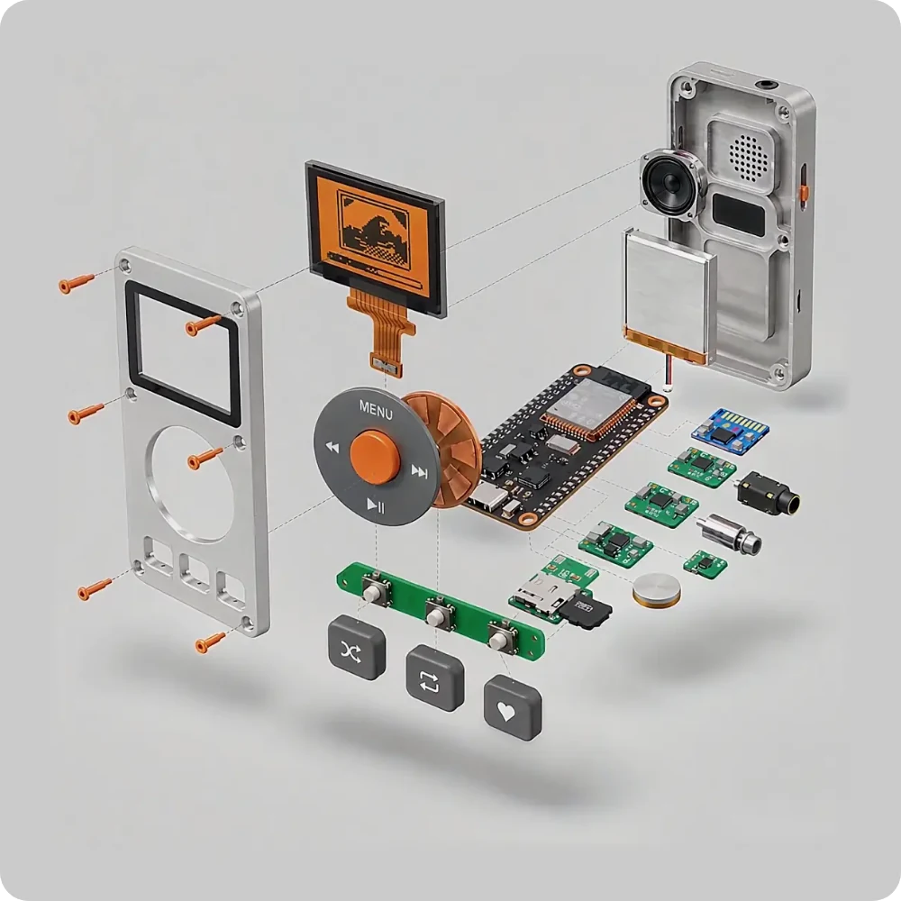
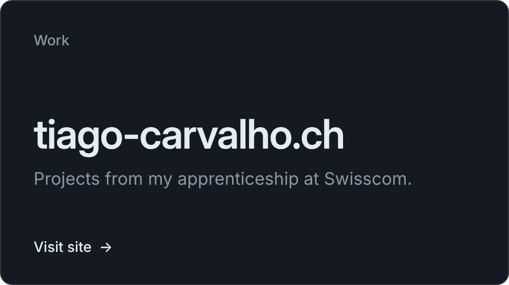
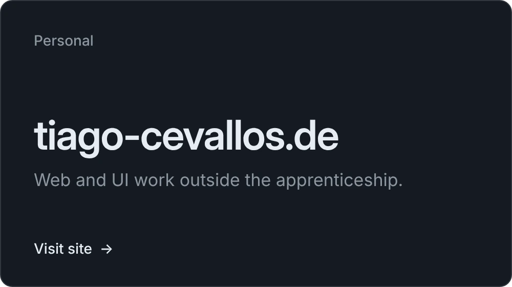
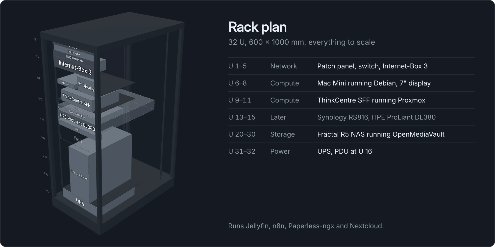
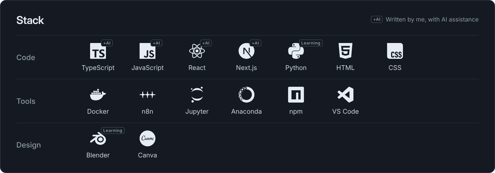
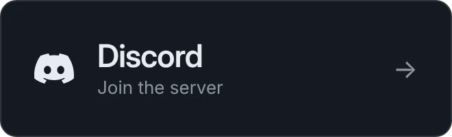
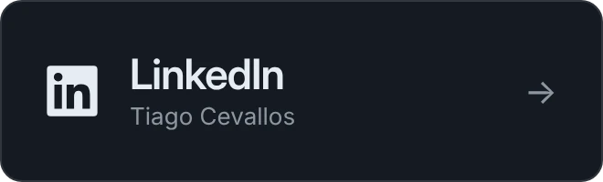

### Hi, I'm Tiago.

Third-year Digital Business Developer apprentice at Swisscom, currently in Group Security. I finish in summer 2028.

Outside of work I build things I can hold or host myself. Right now that is JFP-1, a music player I'm designing from the case to the firmware.

 

## JFP-1

<table>
  <tr>
    <td width="52%" valign="top">
      
    </td>
    <td width="48%" valign="top">
      
My music lives on a Jellyfin server at home. JFP-1 is how I want to take it with me: synced over Wi-Fi, stored on microSD, played offline. No feed and no algorithm deciding what comes next.

      
It is still a prototype. The first case comes off my 3D printer, the finished version gets an aluminium body.

      <table>
        <tr><td>CORE</td><td>ESP32-S3</td></tr>
        <tr><td>DISPLAY</td><td>2.0" IPS, 240 x 320</td></tr>
        <tr><td>INPUT</td><td>Touch wheel, centre button, shuffle, repeat, heart</td></tr>
        <tr><td>AUDIO</td><td>3.5 mm jack, Bluetooth</td></tr>
        <tr><td>STORAGE</td><td>microSD</td></tr>
        <tr><td>BODY</td><td>56 x 118 x 19.5 mm</td></tr>
      </table>
      

        <a href="https://jf-1.duneify.com"><b>Website</b></a> &nbsp;·&nbsp;
        <a href="https://jf-1.duneify.com/#log">Build log</a> &nbsp;·&nbsp;
        <a href="https://jf-1.duneify.com/#join">Waitlist</a> &nbsp;·&nbsp;
        <a href="https://github.com/AbbadonTRD/jf1">Repo</a>
      

    </td>
  </tr>
</table>

 

## Portfolios

  
  

 

## Homelab

Next to it I'm building a Jellyfin music app for iOS, because my favourite client disappeared from the App Store.

 

  
  
  

